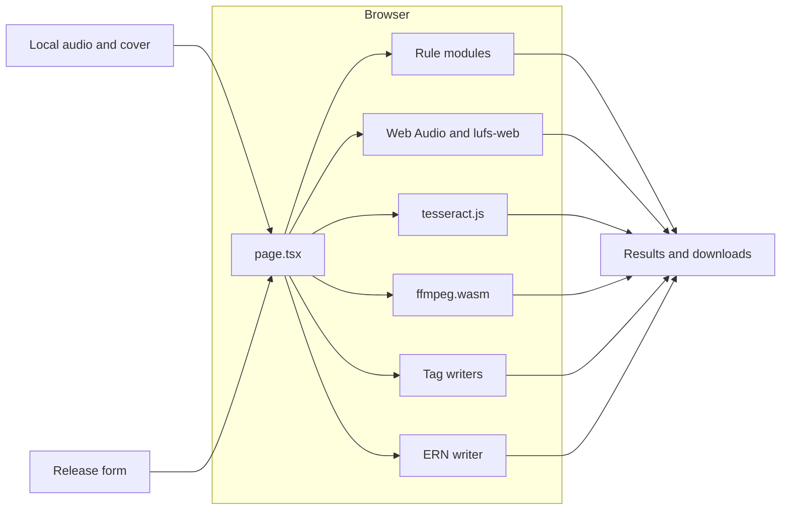
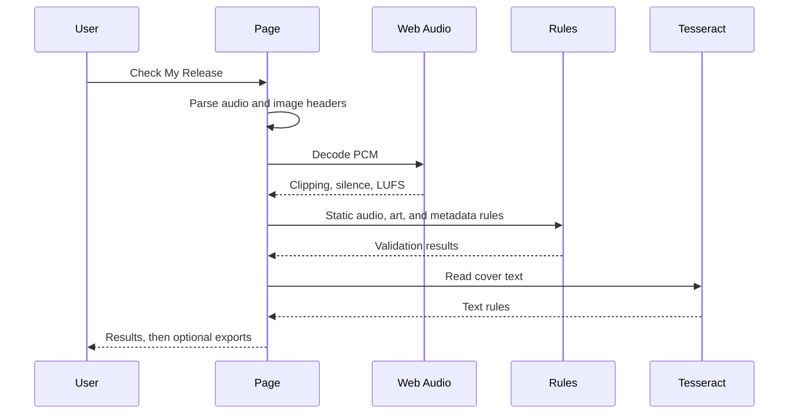
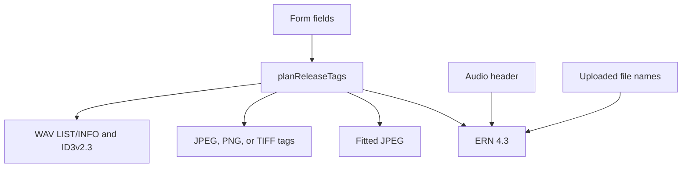
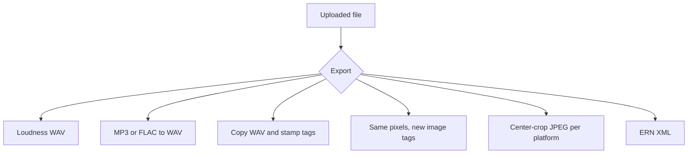
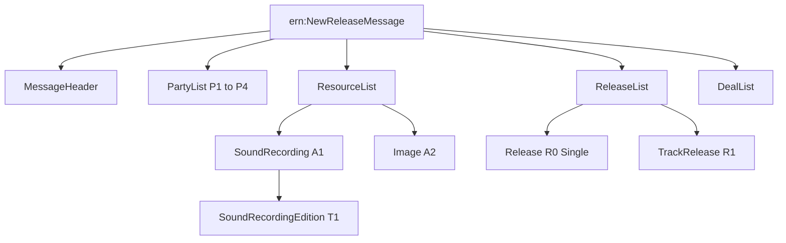

# Metadata Validation Program

A static Next.js app that pre-flights an independent music release in the browser. The user drops in a master and a cover, fills a form, and gets platform results plus corrected files. Audio, images, and metadata never leave the machine. There is no API, no account, and no server-side processing.

The engineering constraint is the product: container parsing, loudness, image metadata, OCR, FFmpeg, and a DDEX ERN 4.3 document all run client-side, including on a static export.

Public guidelines are dated **November 2026** in `src/lib/guidelines.ts`. The checker encodes those rules. It does not claim to be a distributor.

## What is hard about it

- Files are inspected from bytes, not from the extension. A renamed MP3 fails as an MP3.
- Loudness, clipping, and silence are measured from decoded PCM. Tracks longer than three minutes move that work off the main thread.
- WAV, JPEG, PNG, and TIFF metadata are rewritten by hand so a corrected download matches the form and the XML.
- FFmpeg runs as WASM and needs cross-origin isolation. The single-thread core is vendored, and its worker import is patched so webpack does not swallow the blob URL.
- The ERN file is a fill-in template. Empty elements are deliberate. A schema-valid message would have hidden the fields the user still has to complete.

## Architecture



`src/app/page.tsx` is a client component. `next.config.js` sets `output: 'export'` and `trailingSlash: true`, so `next build` emits a static site. Webpack falls back `fs`, `path`, and `crypto` to false because the audio libraries expect Node. `lufs-web` is in `transpilePackages`.

There is one page. Results, downloads, the check console, and the rules chart are components. The rule engine is plain TypeScript and does not import React, so `npm run check` can execute it in Node.

## Check pipeline



The console is a modal that paints between stages. A hash bar creeps while a stage is awaiting. `beforeunload` fires while a check is running. Loudness itself has no internal progress callback, so the bar advances on a timer until `analyzeAudioFile` returns.

Order inside the page:

1. If audio is present, decode it and measure loudness, clipping, and silence.
2. Run `runStaticChecks` on the parsed headers, the image size, and the form.
3. If a cover is present, OCR it and append text rules.
4. Offer exports. Exports do not re-run validation.

## Source of truth

The form wins. Title, artist, featuring, composer, ISRC, and explicit are copied as typed, including values that fail a rule. A blank field stays blank. Original uploads are not modified.



`planReleaseTags` in `src/lib/releaseTags.ts` builds that plan. `tagsAlreadyMatch` compares every present form field with embedded tags. ISRC comparison strips punctuation and uppercases. `imageNeedsRelease` is also true when the cover filename stem differs from the title, case-insensitive. Download stems prefer the title, strip path characters, collapse whitespace, and stop at 80 characters.

## Stack

| Piece | Choice | Role |
| --- | --- | --- |
| App | Next.js 14.2, React 18, TypeScript 5.6 `strict` | Static UI. App Router, one client page. |
| Audio headers | `music-metadata-browser` 2.5 | Container, codec, rate, depth, channels, duration, common tags. |
| WAV format code | Custom RIFF walker | `fmt ` code `0x0001` vs `0xFFFE`. The metadata library does not expose it. |
| Decode | Web Audio `AudioContext` | PCM for loudness and silence. Sample rate is hinted from the file when the browser allows it. |
| Loudness | `lufs-web` 0.1.1 | Integrated LUFS. |
| Transcode | `@ffmpeg/ffmpeg` 0.12.15, util 0.12.2, core 0.12.10 | Single-thread core, about 31 MB, copied to `public/ffmpeg-core`. |
| OCR | `tesseract.js` 5.1, English, LSTM only | Worker, core, and `eng.traineddata.gz` served from `public/tesseract`. |
| XML | Hand-written ERN 4.3 in `src/lib/ddexSkeleton.ts` | Keeps empty elements in the template and writes the ERN 4.3 element order directly. |
| Tests | `tsx` and `scripts/self-check.ts` | Node assertions. No browser, no FFmpeg, no Tesseract. |

`npm install` runs three postinstall scripts: copy Tesseract assets into `public/tesseract` (language data is fetched if missing), copy the FFmpeg core into `public/ffmpeg-core`, and add `/* webpackIgnore: true */` to the FFmpeg worker's dynamic import. Without that comment, webpack tries to bundle a blob URL and FFmpeg fails with a missing module.

## Cross-origin isolation

FFmpeg's WASM needs `SharedArrayBuffer`, which the browser only exposes on a cross-origin-isolated page.

`next.config.js` and `vercel.json` both send:

- `Cross-Origin-Opener-Policy: same-origin`
- `Cross-Origin-Embedder-Policy: require-corp`

`headers()` in the Next config is ignored by `output: 'export'`. `next dev` still sends those headers. A static host has to send them itself. `vercel.json` is that contract for Vercel. `canUseLoudnessFix()` checks for `SharedArrayBuffer` and the UI tells the user to run locally or use a host that sends the headers.

One FFmpeg instance runs at a time. `ffmpeg.terminate()` runs in `finally`. Worker errors arrive as strings and are normalized before they reach the UI.

## Audio inspection

`sniffContainer` reads magic bytes before trusting the parser:

| Signature | Kind |
| --- | --- |
| `RIFF` .... `WAVE` | WAV |
| `fLaC` | FLAC |
| `ID3` or an MPEG frame sync `0xFF` with the top three bits of the next byte set | MP3 |
| `30 26 B2 75` | WMA / ASF |

`parseAudioFile` then uses `music-metadata-browser` and, for WAV, walks chunks to the `fmt ` format code. `actualKind` prefers the sniff, then falls back to the parser's container and codec strings. `AUDIO-01` errors when the extension and the header disagree, including an MP3 renamed to `.wav`.

Decoded analysis lives in `src/lib/analyzeBuffer.ts`.

| Check | Rule | Behavior |
| --- | --- | --- |
| Clipping | `AUDIO-10` | Error if any channel has 3 samples in a row at or above `32767/32768`. The message includes the timestamp. |
| Leading silence | `AUDIO-11` | Warning above 3 seconds. Silence is below −60 dBFS. |
| Trailing silence | `AUDIO-12` | Same threshold, measured from the last audible sample. |
| Spotify loudness | `AUDIO-13` | Target −14 LUFS. Pass from −16 through −8. Otherwise a warning, with the dB the platform will apply. |
| Apple loudness | `AUDIO-14` | Target −16 LUFS. Pass from −18 through −10. Same warning shape. |

Tracks longer than 180 seconds are measured in `src/lib/loudness.worker.ts`. The worker receives transferred channel buffers and has a 120 second timeout. If the worker fails, the page measures on the main thread. If decode fails, `AUDIO-10` through `AUDIO-14` come back as warnings instead of a thrown error.

## Rule catalog

Every result is `{ id, platform, severity, message, fix }`. Severity is `error`, `warning`, or `pass`. A non-pass result must carry a fix. `platform` is `spotify`, `apple`, `distrokid`, `tunecore`, `cdbaby`, or `all`.

TuneCore and CD Baby were added beside the original Spotify, Apple, and DistroKid rules. Several IDs are reused with a different `platform`. `ART-01` on Spotify is the 640 px check. `ART-01` on TuneCore is the 1600 px check. Callers that care about one platform filter on `platform`.

### Audio format

| ID | Platform | Severity | Rule |
| --- | --- | --- | --- |
| `AUDIO-01` | all | error | Extension must be wav, flac, or mp3, and must match the header. Non-PCM WAV format codes fail here. `0x0001` and `0xFFFE` continue. |
| `AUDIO-02` | spotify | error | 16-bit or 24-bit. MP3 passes without a bit depth. Unreadable depth is a warning. |
| `AUDIO-03` | spotify | error | 44.1 kHz or higher. Unreadable rate is a warning. |
| `AUDIO-04` | spotify | error | Stereo. |
| `AUDIO-05` | spotify | error | WAV must be standard PCM `0x0001`. `WAVE_FORMAT_EXTENSIBLE` (`0xFFFE`) fails. Non-WAV passes. |
| `AUDIO-06` | distrokid | warning | 16-bit WAV is the documented standard. Other depths warn. Non-WAV passes. |
| `AUDIO-15` | cdbaby | error | File name must match `^[a-zA-Z0-9_-]+\.[a-zA-Z0-9]+$`. |
| `AUDIO-16` | tunecore | warning | Guidance is 44.1 kHz, 16-bit, stereo WAV or FLAC. A mismatch warns. It does not error. |
| `AUDIO-17` | cdbaby | warning | Same guidance as TuneCore. |
| `DK-02` | distrokid | warning | WMA is accepted and discouraged. |

Apple has no separate audio-format rule beyond the shared file check and `AUDIO-14`. Spotify's sample-rate rule is "or higher." TuneCore and CD Baby want exactly 44.1 kHz.

### Cover art

Sizes and formats live in `COVER_SPECS` in `src/lib/rules/platformSpecs.ts`.

| Platform | Edge | Formats | File size |
| --- | --- | --- | --- |
| Spotify | 640–10000 | JPG, PNG, TIFF | not checked |
| Apple Music | 4000–10000 | JPG, PNG, GIF | not checked |
| DistroKid | 1000 minimum, 3000 recommended, 10000 max | JPG | not checked |
| TuneCore | 1600–3000 | JPG, PNG, GIF | under 10 MB |
| CD Baby | 1400–3000 | JPG, JPEG, PNG, GIF | under 25 MB |

| ID | Platform | Severity | Rule |
| --- | --- | --- | --- |
| `ART-01` | spotify, tunecore, cdbaby | error | Below that platform's minimum. |
| `ART-02` | spotify, tunecore, cdbaby | error | Above that platform's maximum. |
| `ART-03` | apple | error | Below 4000 px. |
| `ART-04` | distrokid | error, then warning | Below 1000 is an error. 1000–2999 is a warning. 3000 and up passes. |
| `ART-05` | all | error | Must be square. |
| `ART-06` | spotify | warning | TIFF, PNG, or JPEG preferred. |
| `ART-06` | tunecore, cdbaby | error | Format must be in that platform's list. `jpeg` folds to `jpg`, `tif` to `tiff`. |
| `ART-07` | tunecore | error | 10 MB or larger. The comparison is `mb < max`, so a file exactly at the cap fails. |
| `ART-08` | cdbaby | error | 25 MB or larger. Same strict comparison. |
| `DK-01` | distrokid | warning | JPEG preferred. |

No single square size passes Apple's 4000 px minimum and TuneCore or CD Baby's 3000 px maximum. That conflict is called out in the UI.

Color space and DPI are not read. Browsers do not reliably expose CMYK versus sRGB, or TuneCore's 72 dpi floor.

### Metadata and cover text

| ID | Platform | Severity | Rule |
| --- | --- | --- | --- |
| `META-01` | spotify | error | Title contains `(Remix)`, `(Live)`, `(Remastered)`, or `(Deluxe)`. |
| `META-02` | spotify | error | Artist contains feat, ft, featuring, or prod. by. |
| `META-03` | all | error | Title and artist are required. Two results, one per field. |
| `META-04` | spotify | error | Artist contains christmas, sleep, meditation, rain sounds, or baby. |
| `META-05` | apple | warning | Title letters are all caps and there are at least two letters. |
| `META-06` | spotify | warning | Composer is empty, one word, or contains a period. |
| `META-07` | tunecore | error | Cover text contains new, latest, exclusive, or limited edition. |
| `META-08` | cdbaby | error | Same time-sensitive words. |
| `OCR-01` | all | warning | Artist not found in cover text, or the cover could not be read. |
| `OCR-02` | all | warning | Title not found in cover text. |
| `OCR-03` | all | error | URL, domain, `@handle`, or a dollar price. The message names Spotify and Apple. |
| `OCR-04` | apple | error | The words Explicit or Parental Advisory are on the art. |
| `ART-09` | tunecore | warning | Proxy for an exact cover-text match. The word set differs from the artist and title. |
| `ART-10` | cdbaby | warning | Same word-set proxy. |

`ART-09` and `ART-10` are a proxy for the real TuneCore and CD Baby rule, not a substitute. Those platforms can reject a cover when the artist and title are in a different order, or when the punctuation differs. This check folds case, strips accents, and compares the set of words. A cover that reads "Artist – Track" passes against metadata that reads "Track – Artist". The result says so: it checks that the words match, and it does not check order or punctuation. A missing artist or title skips the check. OCR is best-effort. Covers whose long edge exceeds 2000 px are scaled to a PNG before recognition. The worker is created with `workerBlobURL: false` and local paths under `public/tesseract`.

## Corrections

Exports are optional and explicit. Each one builds a new blob.



### Loudness and conversion

`renderWav` in `src/lib/fixLoudness.ts` loads the local core through blob URLs, writes the input, and runs FFmpeg.

Loudness:

```text
-af loudnorm=I=-14|I=-16:TP=-1.0:LRA=11 -ar 44100 -map_metadata -1
```

`I` is integrated loudness: −14 LUFS for Spotify, −16 for Apple. `TP=-1.0` is the true-peak ceiling in dBTP. `LRA=11` is the loudness range, in LU, that `loudnorm` steers toward. The check only measures integrated LUFS. The fix also reshapes dynamic range, so a heavily compressed master can come back with a different character than a gain change alone would produce. The output name is `{title}-normalized-{14|16}lufs.wav` when the form has a title.

Conversion keeps the source bit depth when it can: `pcm_s24le`, `pcm_s32le`, otherwise `pcm_s16le`. Sample rate is left alone. An MP3 conversion cannot restore samples the MP3 discarded. The UI says so.

`-map_metadata -1` drops source tags. If the form has any release field, `stampWavTags` writes them afterward.

### WAV tags

`src/lib/wavTags.ts` rebuilds the RIFF container and keeps the PCM `data` chunk.

| Store | Fields |
| --- | --- |
| LIST/INFO | `INAM` title, `IART` artist, `IWRI` composer, `ISRC`, `ICMT` caption. Latin-1 only. A character above 255 drops that INFO item. |
| ID3v2.3 | `TIT2`, `TPE1`, `TCOM`, `TSRC`, plus `TXXX` Featuring and `TXXX` Explicit. Text frames are UTF-16. |

The caption is labeled lines from `releaseCaption`. Existing INFO and ID3 chunks are removed so old tags do not survive. `music-metadata` prefers ID3 over INFO, which is why both are written.

### Image tags

`writeReleaseImage` returns the same container type. Pixel data is unchanged on this path.

| Container | What is written |
| --- | --- |
| JPEG | A new EXIF APP1: `0x010E` ImageDescription, `0x013B` Artist, `0x9C9B` XPTitle, `0x9C9D` XPAuthor. Orientation `0x0112` is copied from the old EXIF. Old EXIF, XMP, and IPTC segments are dropped. XMP gets `dc:title`, `dc:creator`, and `dc:description`. IPTC gets 1:90 UTF-8, 2:5 object name, 2:80 by-line, and 2:120 caption. |
| PNG | `iTXt` keywords Title, Author, Featuring, Composer, ISRC, Explicit, and Description, inserted before IEND. IDAT is preserved. Matching text chunks are replaced. |
| TIFF | IFD0 is rewritten at the end of the file for `0x010E` and `0x013B`. Earlier image bytes stay put. Little- and big-endian TIFF are both accepted. |

Featuring, composer, ISRC, and explicit travel in the caption for JPEG and TIFF, and as their own PNG keywords. If every form field is blank, nothing is stamped.

### Fitted covers

`fitCoverFile` center-crops the largest square, draws it to a canvas, and encodes JPEG. The edge comes from `coverExportEdge`: the crop side, then clamped between the platform floor and `spec.max`. DistroKid's floor is 3000, so the download meets the recommendation rather than only the 1000 px error line.

Quality starts at 0.92 and drops by 0.08 until the file is under the platform cap or quality reaches 0.5. TuneCore is 10 MB. CD Baby is 25 MB. Spotify, Apple, and DistroKid have no byte cap in this step. The JPEG is then stamped with the form tags. The file name is `{title}-{platform}.jpg`. Enlarging a small cover does not add detail. The UI says to look at the file.

## ERN 4.3

`buildSkeletonXml` writes `release-metadata-skeleton.xml`. It does not call the DDEX Workbench. It does not invent a UPC, a label, a genre, a deal, or a hash.



Root attributes are `LanguageAndScriptCode="en"`, `ReleaseProfileVersionId="SimpleAudioSingle"`, and `AvsVersionId="12"`. `MessageSchemaVersionId` is not an attribute and is not emitted. `schemaLocation` points at the official 4.3 XSD.

| Anchor | Meaning |
| --- | --- |
| P1 | Main artist. Name from the form, or empty. |
| P2 | Label. `FullName` is empty. |
| P3 | Featuring artist. Second `DisplayArtist` with role `FeaturedArtist`. |
| P4 | Composer. `Role` is `Composer`. |
| A1 / T1 | Sound recording. Type `MusicalWorkSoundRecording`. |
| A2 / T2 | Front cover. Proprietary id `cover-001`. |
| R0 | Release type `Single`. |
| R1 | Track release. No `ReleaseType`. `Track` is not a valid ERN 4.3 release type. |

Filled values come from the form and the audio header: title, artist, featuring, composer, ISRC, explicit (`Explicit` or `NotExplicit`), codec (`PCM`, `FLAC`, `MP3`, `WMA`), channels, sample rate, bits, duration as `PT#H#M#S`, and file URIs. Duration is omitted as an empty element when the header has no duration. `isoDuration` returns `''` for unknown input rather than `PT0M0S`.

Always present and empty when unknown: GRid, ICPN, label name, genre, deal territory, start date, commercial model, use type, hash algorithm, and hash value. Sender DPID is `PADPIDA0000000001X`. Recipient DPID is `PADPIDA0000000002X`. Both are placeholders.

`DealList` is included with empty children so the user has the slots. An empty `ReleaseDeal` is not valid against the XSD, because `ReleaseDeal` requires deal terms that this template leaves blank. The UI says Workbench may reject the file until those fields are filled. That tradeoff is intentional: a base file, not a delivery message.

On phones, the XML blob opens in a new tab instead of using the download attribute. Desktop uses a temporary object URL and a click on an `<a download>`.

## Interface

The page is a dark monospace layout. The braille mark and the ASCII title are scaled by `FitArt` so they do not grow their own scrollbars. The page itself scrolls.

The rules chart is a dialog launched from "Understand the rules." Its numbers are read from `COVER_SPECS`, `AUDIO_SPECS`, and `coverFileLimitMB`, with the DistroKid 1000 / 3000 split written out because a single range would hide the warning band. Escape, the close button, and a backdrop click dismiss it.

Contact sits at the bottom of the page: [holly@hollyteunis.info](mailto:holly@hollyteunis.info) and [buy me a coffee](https://buymeacoffee.com/hollyteunis).

## Repository

```text
src/app/page.tsx                 client page and check orchestration
src/app/layout.tsx               title and description
src/components/                  drops, form, results, console, exports, chart
src/lib/analyzeBuffer.ts         clipping, silence, LUFS rules
src/lib/analyzeAudioFile.ts      decode and the long-track worker
src/lib/validateAudio.ts         sniff, WAV fmt, music-metadata
src/lib/validateImage.ts         decode plus embedded image tags
src/lib/validateOcr.ts           local Tesseract worker
src/lib/runChecks.ts             static rule assembly
src/lib/rules/                   one module per rule family, plus platformSpecs
src/lib/fixLoudness.ts           FFmpeg loudness and WAV conversion
src/lib/wavTags.ts               RIFF LIST/INFO and ID3v2.3
src/lib/imageTags.ts             JPEG, PNG, and TIFF tag rewrite
src/lib/fitCover.ts              per-platform JPEG
src/lib/releaseTags.ts           form plan and filename stems
src/lib/ddexSkeleton.ts          ERN 4.3 template
scripts/self-check.ts            Node assertions
scripts/copy-tesseract-assets.mjs
scripts/copy-ffmpeg-core.mjs
scripts/patch-ffmpeg-worker.mjs
public/ffmpeg-core/              vendored single-thread core
public/tesseract/                vendored worker, core, English data
vercel.json                      COOP and COEP for a static deploy
```

## Develop

```bash
npm install
npm run dev
npm run check
npx tsc --noEmit
npm run build
```

`npm run dev` is the path that serves isolation headers. `npm run check` asserts rule outcomes, WAV and image tag round trips, cover export edges, and the shape of the XML, including empty deal and identifier elements. It does not decode a real song, run FFmpeg, or run OCR.

Run `npm run build` when the dev server is not already writing `.next`. A build against a live dev server can break the dev chunks.

The static export does not apply `headers()` from `next.config.js`. Loudness and WAV conversion on a deployed build depend on the host sending the two isolation headers.

## Boundaries

- No copyright, sample-clearance, or AI-disclosure check.
- No Apple artist-id match.
- No CMYK or DPI check.
- No DDEX Workbench call, and the template is not a delivery file.
- OCR misses stylized type. Text rules are warnings except promotional text, the Apple explicit-label words, and the TuneCore / CD Baby time-sensitive words.
- A loudness fix targets integrated LUFS and a loudness range of 11 LU. It changes level and can change the character of a heavily compressed master. It does not restore dynamics.
- A fitted JPEG can upscale. It does not invent detail.
- Explicit on the form is written into files and XML. The cover check only flags the words Explicit and Parental Advisory printed on the art.
- CD Baby featuring-credit matching and language consistency are not implemented. Exact cover text is a warning, not a hard error.

[](https://github.com/HMTEUNIS/release_metadata_validator)
